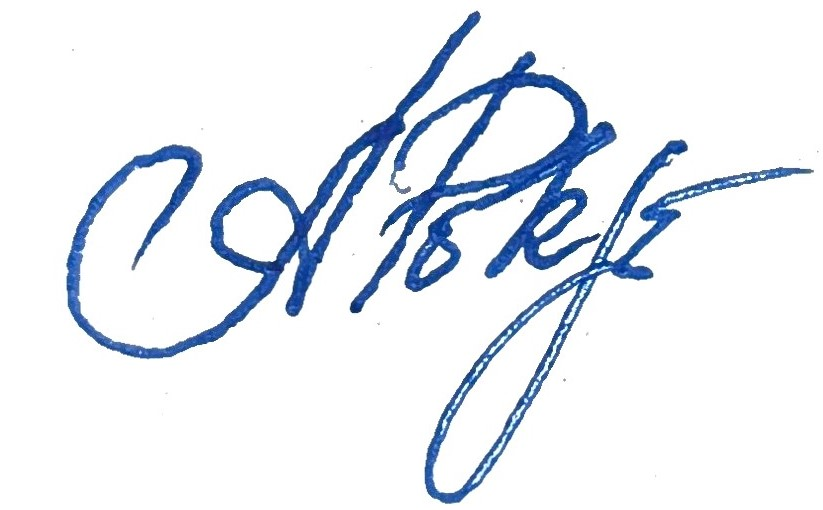

[%nonfacing]
[%notitle]
ifdef::all[== Bewerbung]

[.txt-center.head-h1]
*OLEKSII POKROVSKYI*
[.txt-center.head-h2]
*C# / .NET SOFTWARE DEVELOPER | SOFTWARE ARCHITECTURE | TESTING | DEVOPS*

[.txt-center]
Speyer, Germany • +49 170 2884753 • alex.pokrowskiy@gmail.com • https://www.linkedin.com/in/alex-pokrowskiy[LinkedIn] • https://wa.me/qr/QKHRAB5ZAMIUK1[WhatsApp]

{empty} +

[.txt-sml.fgray]#Oleksii Pokrovskyi, Windthorst Str. 15, 67346 Speyer#

InnetiQs GmbH +
Fraunhoferstraße 5 +
76297 Stutensee-Blankenloch +
Deutschland +

{empty} +

[.txt-right]
Speyer, {revdate} 

{empty} +

[.fhel.fblue.head-h2]
*Bewerbung als Desktop Softwareentwickler C# / .NET (m/w/d)*

// Ihre Stellenanzeige bei LinkedIn vom xx.xx.xxxx
Ihre Stellenanzeige auf Bundesagentur für Arbeit +
// Einsatzorte: Siegburg +
Referenz-Nr.: 12288-4991504946-S

{empty} +

Sehr geehrte Frau Kummle,

mit großer Begeisterung habe ich Ihre Stellenanzeige für die Position als Desktop Softwareentwickler C# / .NET gelesen. Die Entwicklung von innovativen Inspektionssystemen zur Analyse und Visualisierung wichtiger Messdaten ist eine sehr verantwortungsvolle Aufgabe. Ich möchte mein technisches Wissen gerne in Ihr Team einbringen und gemeinsam mit Ihnen zuverlässige Softwarelösungen gestalten.

Ich verfüge über fast 20 Jahre professionelle Erfahrung in der Softwareentwicklung. In meinen bisherigen Projekten für internationale Unternehmen habe ich komplexe Desktop-Anwendungen sowie Datenbankarchitekturen entwickelt und betreut.

Folgende Qualifikationen bringe ich für die Stelle bei InnetiQs mit:

* *Langjährige C# und .NET-Erfahrung:* Ich beherrsche die moderne Entwicklung im .NET-Umfeld und kenne mich bestens mit der Erstellung performanter Datenbank-Anwendungen (u. a. MS SQL, Oracle, PostgreSQL) aus.

* *Benutzeroberflächen & Architekturen:* Ich habe umfassende praktische Erfahrung in der Entwicklung von Desktop-Anwendungen mit WPF und WinForms unter Anwendung des MVVM-Entwurfsmusters.

* *Hohe Qualitätsstandards:* Sauberer Code (Clean Code), testgetriebene Entwicklung (TDD) sowie automatisierte Unit-Tests mit NUnit gehören zu meiner täglichen Praxis.

* *Internationale Dokumentation & Sprachen:* Meine Deutschkenntnisse liegen auf dem Niveau B1 und ich lerne stetig weiter. Ich spreche fließend Englisch und bin gewohnt, die gesamte technische Dokumentation präzise auf Englisch zu verfassen.

Für meinen beruflichen Neustart in Deutschland suche ich eine langfristige Ersteinstellung, bei der die praxisnahe Zusammenarbeit, wertvolle Erfahrungen im deutschen Arbeitsumfeld und spannende technische Herausforderungen für mich im Vordergrund stehen.

Aufgrund meines Wohnorts Speyer ist der Standort Stutensee für mich sehr gut erreichbar. Ich bin ab sofort verfügbar und stehe Ihnen im Vollzeitverhältnis gerne zur Verfügung. Um Sie von meinen fachlichen Fähigkeiten zu überzeugen, stehe ich auch für eine Probearbeit gerne bereit.

Über eine Einladung zu einem persönlichen Gespräch freue ich mich sehr.

{empty} +

[%unbreakable] 
--
Mit freundlichen Grüßen aus Speyer 

:figure-caption!:
.Oleksii Pokrovskyi

--
