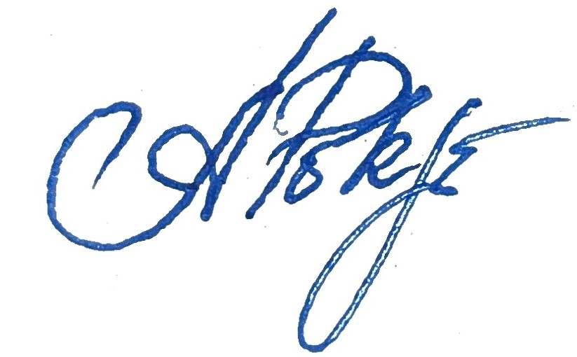

[%nonfacing]
[%notitle]
ifdef::all[== Bewerbung]

[.txt-center.head-h1]
*OLEKSII POKROVSKYI*
[.txt-center.head-h2]
*C# / .NET SOFTWARE DEVELOPER | SOFTWARE ARCHITECTURE | TESTING | DEVOPS*

[.txt-center]
Speyer, Germany • +49 170 2884753 • alex.pokrowskiy@gmail.com • https://www.linkedin.com/in/alex-pokrowskiy[LinkedIn] • https://wa.me/qr/QKHRAB5ZAMIUK1[WhatsApp]

{empty} +

[.txt-sml.fgray]#Oleksii Pokrovskyi, Windthorst Str. 15, 67346 Speyer#

ALTEN GmbH +
Frankfurter Ring 81 +
80807 München +
Deutschland +

{empty} +

[.txt-right]
Speyer, {revdate} 

{empty} +

[.fhel.fblue.head-h2]
*Bewerbung als Senior Softwareentwickler C# .NET (w/m/d)*

// Ihre Stellenanzeige bei LinkedIn vom xx.xx.xxxx
// Ihre Stellenanzeige auf Bundesagentur für Arbeit +
Einsatzorte: Siegburg 
// Referenz-Nr.: SF-5678

{empty} +

Sehr geehrte Frau Manglkammer,

mit großer Begeisterung habe ich Ihre Stellenanzeige für die Position als System & Integration Engineer bei der ALTEN Consulting Services GmbH gelesen. Sie suchen einen engagierten Spezialisten für die Konzeption, Softwareentwicklung und Integration komplexer Kommunikations- und Plattformsysteme. Da diese Aufgaben genau meinen Qualifikationen und meiner beruflichen Leidenschaft entsprechen, möchte ich mich Ihnen sehr gerne vorstellen.

Ich habe mein Studium der Angewandten Programmierung (Bachelor) erfolgreich abgeschlossen und verfüge über fast 20 Jahre praktische Erfahrung in der Softwareentwicklung und Systemintegration. Während meiner bisherigen Laufbahn habe ich intensiv mit C# und .NET sowie modernen Datenbanken und Schnittstellen gearbeitet. Darüber hinaus bringe ich fundierte Erfahrung in der System- und Netzwerkbetreuung, der Fehleranalyse sowie im Erstellen von technischen Dokumentationen und Schnittstellenbeschreibungen mit.

Für mich steht aktuell der Einstieg in den deutschen Arbeitsmarkt im Vordergrund. Ich suche gezielt nach meiner ersten Arbeitsstelle in Deutschland, um wertvolle Praxiserfahrung in einem starken Team zu sammeln, mich kontinuierlich weiterzuentwickeln und Ihre Projekte verlässlich zu unterstützen. Aus diesem Grund steht das Sammeln von Praxiserfahrung und die erfolgreiche Einarbeitung für mich an erster Stelle.

Ich spreche sehr gut Englisch und verfüge über gute Deutschkenntnisse (B1-Niveau), die ich täglich weiter ausbaue. Ich arbeite stets strukturiert, eigenständig und lösungsorientiert und füge mich schnell und gerne in neue Teams ein.

Gerne überzeuge ich Sie von meinen Fachkenntnissen und meiner Einsatzbereitschaft im Rahmen eines persönlichen Gesprächs oder auch während eines Probearbeitstages. Ich freue mich sehr über eine Einladung.

{empty} +

[%unbreakable] 
--
Mit freundlichen Grüßen aus Speyer 

:figure-caption!:
.Oleksii Pokrovskyi

--
